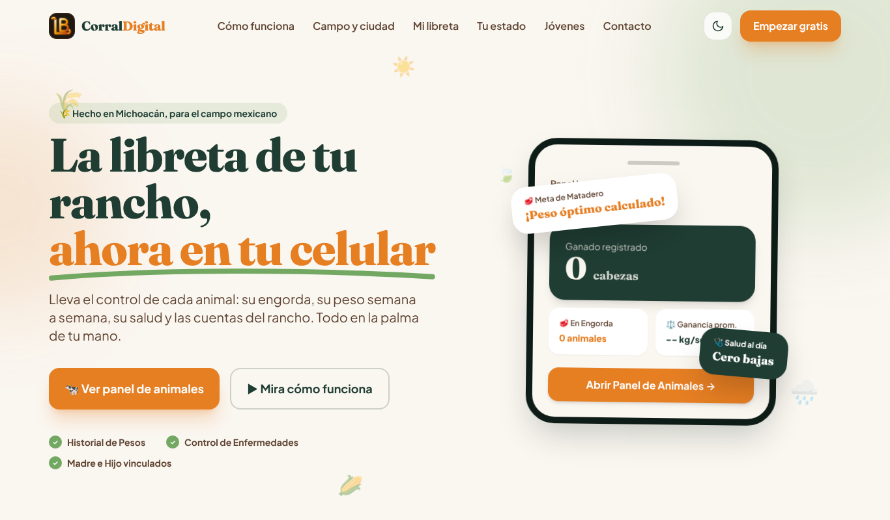
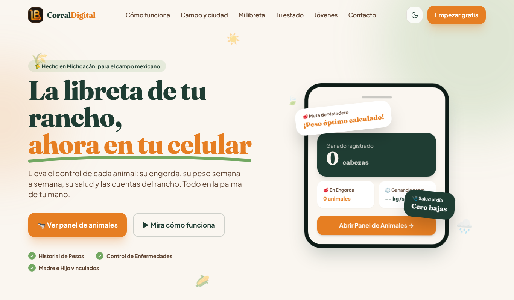
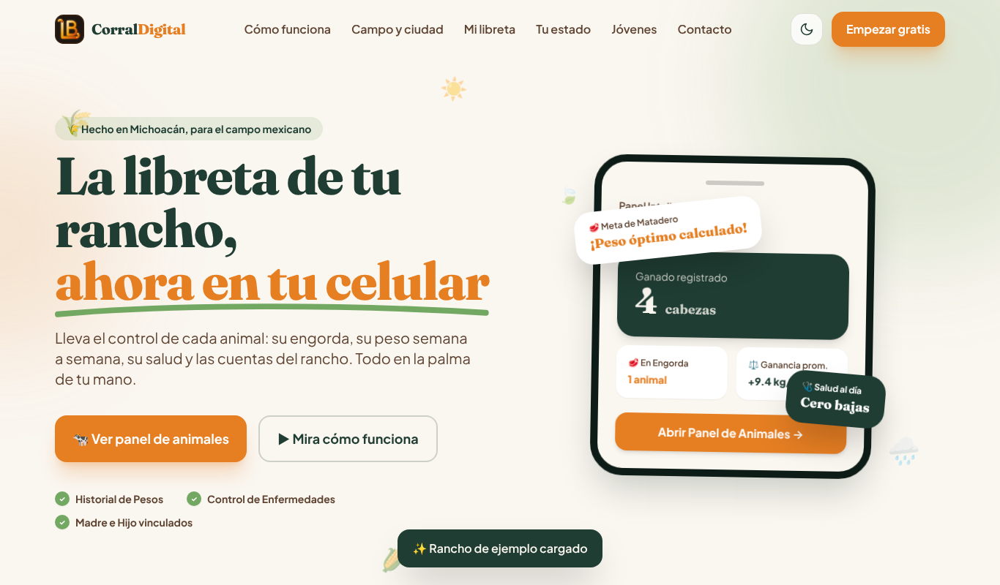
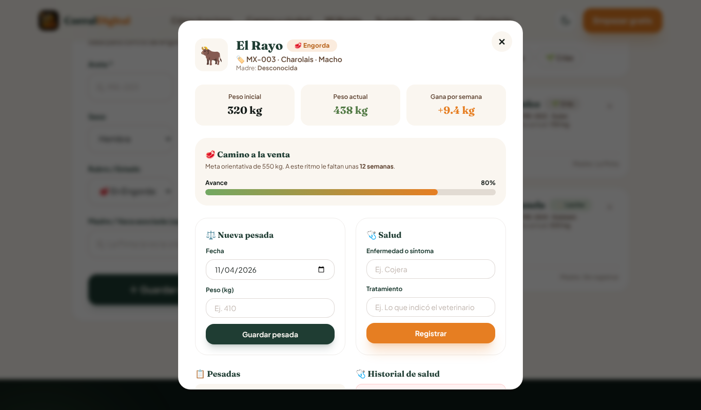
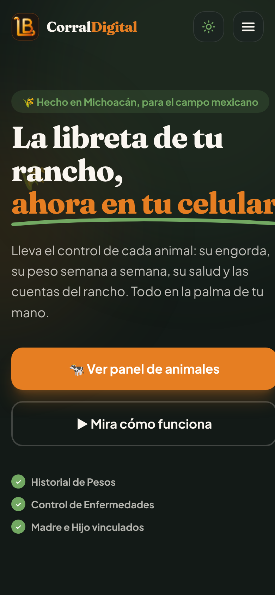

# 🐄 Corral Digital
> La libreta de tu rancho, ahora en tu celular. **Sin campo, no hay ciudad.**

🔗 **Sitio publicado:** https://AnaBazan12.github.io/corral-digital/
📦 **Repositorio:** https://github.com/AnaBazan12/corral-digital

---

## 📌 Descripción
Corral Digital es una página web interactiva para **pequeños ganaderos de Michoacán** que hoy llevan el control de su rancho en libreta, y para los **jóvenes de familias ganaderas** que pueden ayudarles a usar la tecnología.

El proyecto nace de una idea: del campo sale la pastura, el clima es el que manda en los alimentos y en la ganadería, y **sin el campo la ciudad y la industria no funcionan**. La página busca conectar a las personas de la ciudad con el origen de lo que comen, y darle al ganadero una herramienta sencilla, en su idioma, para cuidar su ganado y sus cuentas.

Une mi formación en desarrollo de software con el mundo del rancho: **del corral al código**.

## ✨ Funcionalidades
| Sección | Qué hace |
|---|---|
| 🔥 Nuestro fierro | Ilustración animada del fierro de herrar con el logo al rojo vivo y la historia de la marca |
| 📱 Simulador en el celular | Demo animada que se reproduce sola (o paso a paso) y muestra cómo registrar una vaca, pesarla, recibir el aviso de parto y ver las cuentas. Se puede pausar y solo corre cuando está a la vista. |
| 🇲🇽 La ganadería en tu estado | Eliges el estado y muestra su región en un mini mapa, clima, tipo de ganadería, problemáticas, apoyos y cómo mejorar. Incluye alerta nacional del gusano barrenador. |
| 🌎 Sin campo no hay ciudad | Cadena animada Clima → Pastura → Ganado → Alimento → Ciudad |
| ☁️ El clima es el que manda | Elige la temporada (lluvias, secas, frío) y muestra qué cuidar en pastura, alimento y ganado. Abre sola en la temporada actual. |
| 🍽️ ¿Qué comiste hoy? | Toca tu desayuno y descubre de dónde viene (conecta a la ciudad con el campo) |
| 🤔 ¿Por qué cambiar? | Antes (libreta) vs. Después, y tarjetas de Mito vs. Realidad que se voltean |
| 🐄 Mi Corral | Registro de animales con buscador, filtros y contadores animados |
| 📋 Panel por animal | Historial de pesadas, ganancia de kg por semana, meta de engorda, control de salud y madre/cría |
| 🍼 Partos | Calculadora (283 días de gestación), barra de avance y calendario |
| 💰 Cuentas | Ventas y gastos, balance que cambia de color |
| 🌉 Jóvenes | Pasos para ayudar a la familia y botón para compartir por WhatsApp |
| 💬 Contacto | Formulario con validación y mensaje de éxito |
| 🌙 Extra | Modo oscuro que se recuerda, 100% responsive y datos guardados en el celular (localStorage) |

**Tip para probarlo:** en "Mi Corral" toca **✨ Cargar rancho de ejemplo**.

## 🎨 Diseño
- **Logo "fierro" LB:** en el rancho, el fierro de herrar es la firma del ganadero. El logo es mi fierro personal con las letras **LB** (Lizeth Bazán): la L con pata larga que sostiene a la B y remates enroscados de hierro forjado, al rojo vivo (degradado de calor + brillo en SVG). Aparece en el menú, el pie de página, el simulador, el favicon y en la sección animada "Nuestro fierro" (brillo de calor, humo y chispas).
- **Tipografías:** Fraunces (títulos) y Plus Jakarta Sans (texto).
- **Paleta "Tierra moderna":** verde pradera `#1F3D33`, verde brote `#72A862`, crema trigo `#FAF6F0`, café tierra `#5E4331`, naranja atardecer `#E67E22`.
- **Animaciones:** aparición escalonada al hacer scroll, cinta de palabras infinita, emojis flotantes, flechas que avanzan en la cadena, números que cuentan, brillo en botones, panel que entra suave, campos que vibran cuando hay un error. Se desactivan si el usuario prefiere menos movimiento.

## 🛠️ Herramientas
- **IA principal:** Claude (Anthropic) · **apoyo:** Gemini (Google) para el módulo del panel por animal
- **Frontend:** HTML5, Tailwind CSS (compilado con Tailwind CLI e incrustado) y JavaScript vanilla, en un solo `index.html`
- **Publicación:** GitHub Pages

## 🧠 Prompts utilizados (Rol, Tarea, Contexto, Restricciones)

### 1. Prompt inicial
> **Rol:** Actúa como un desarrollador web experto en Frontend y Tailwind CSS, especializado en crear interfaces modernas, limpias, altamente responsivas y fáciles de usar para personas con poca experiencia tecnológica.
>
> **Tarea:** Construye una aplicación web tipo landing interactiva llamada "Corral Digital" con el lema "La libreta de tu rancho, ahora en tu celular", en un solo archivo index.html, que incluya: navbar con modo oscuro y menú hamburguesa; héroe; "¿Por qué cambiar?" con Antes vs Después y Mitos vs Realidad; "Mi Corral" con registro, buscador, filtros y contadores; calculadora de parto bovino (283 días); "Mis Cuentas" con ingresos, gastos y balance; sección "Tú eres el puente" para jóvenes; formulario de contacto validado; y footer con mi nombre.
>
> **Contexto:** El público principal son pequeños ganaderos de Michoacán que llevan el control en libreta y desconfían de la tecnología; el secundario son jóvenes de familias ganaderas. Debe transmitir confianza, cercanía y orgullo por el campo, con lenguaje sencillo del rancho y un diseño moderno.
>
> **Restricciones:** HTML5, Tailwind CSS por CDN y JavaScript vanilla, en un solo archivo. Mobile first y 100% responsivo. Guardar datos y modo oscuro en localStorage. Todos los botones, filtros y formularios deben funcionar. Validar campos vacíos y montos negativos. Animaciones suaves, sin imágenes externas, todo en español y código comentado.

### 2. Iteraciones
1. *"Hazla de manera profesional y responsive, usa tipografías, paleta de colores, crea el logo y sobre todo mejórala; vuela tu creatividad."* → logo, tipografías, celular con datos en vivo y rancho de ejemplo.
2. *(Gemini)* Se agregó el **panel individual por animal**: pesadas, ganancia semanal, meta de engorda, salud y vínculo madre-cría.
3. *"Dos no funcionan. Del campo sale la pastura, el clima es el que manda en los alimentos y en la ganadería; sin el campo la ciudad y la industria no funcionan. ¿Cómo conectar con las personas? Arregla los errores y añade animaciones."* → sección "Sin campo no hay ciudad", selector de clima, "¿Qué comiste hoy?", corrección de errores y animaciones.

4. *"¿Por qué no le agregas un simulador en el celular de cómo funciona? También información de lo que pasa en el mundo de la ganadería: que el usuario seleccione, por ejemplo, México, qué estado, dónde se ubica, qué apoyos hay y cómo podemos mejorar las problemáticas."* → simulador animado y sección "La ganadería en tu estado" (los apoyos se verificaron con búsqueda en noticias de 2026).

5. *"Quiero mi logo algo así (un fierro de herrar al rojo vivo)… pueden ser mis letras LB."* → logo "fierro" con las letras **LB** en SVG, favicon y sección animada "Nuestro fierro".

## 🪙 Gestión de tokens
Para no agotar los límites de la IA:
- Todo el sitio vive en **un solo `index.html`**, así cada iteración trabaja sobre un archivo y no sobre muchos.
- Después del prompt inicial, cada mejora se pidió **por bloques** ("agrega el simulador", "cambia el logo") en lugar de regenerar la página completa.
- Los errores se corrigieron con prompts puntuales del tipo *"Ocurrió este error [...], corrígelo y explícame por qué sucedió"*.
- Gemini se usó solo para un módulo (panel por animal) y después se integró y corrigió con Claude.

## 🐞 Errores encontrados y corregidos
| # | Error | Causa técnica | Solución |
|---|---|---|---|
| 1 | Los botones **"¿Por qué cambiar?"** y **"Así de fácil"** del menú no hacían nada | Al regenerar con Gemini se borraron las secciones `#por-que` y `#como`, pero los enlaces `href="#..."` se quedaron apuntando a ids que ya no existían | Se restauró `#por-que` y el menú se reorganizó con la nueva sección `#campo` |
| 2 | Las fechas salían **un día antes** (ej. 30 sep en lugar de 1 oct) | `new Date('2026-10-01')` interpreta el texto en hora **UTC**; en México (UTC-6) eso es todavía el día anterior | Función `aFecha()` que arma la fecha en hora local: `new Date(año, mes-1, día)` |
| 3 | Animales guardados antes mostraban **"undefined"** y "Guardar pesada" tronaba | La versión nueva esperaba `pesajes` y `madre`, pero los datos viejos del localStorage solo tenían `peso` (`undefined.push()` lanza `TypeError`) | Al cargar, se completan los datos que falten para que sean compatibles |
| 4 | "Ganancia prom." se quedaba siempre en **"-- kg/sem"** | El elemento `#hero-ganancia` nunca se actualizaba en `renderHero()` | Se calcula el promedio de ganancia semanal de los animales en engorda |
| 5 | Si no ponías peso, se registraban **300 kg inventados** | Valor por defecto fijo en el código | Ahora el peso es opcional y se valida entre 1 y 2000 kg |
| 6 | La calculadora decía **"¡Es hoy!"** aunque el parto ya hubiera pasado, y aceptaba montas en el futuro | Solo se revisaba `faltan > 0`; cualquier otro caso caía en "Es hoy" | Se distinguen los 3 casos y se bloquean fechas futuras |
| 7 | Los partos no se podían borrar, se podían duplicar y mostraban **"-12d"** | Faltaba el botón y la validación de duplicados | Botón ✕, aviso si la vaca ya tiene parto y etiqueta "Ya pasó" |
| 8 | El panel del animal solo cerraba con la ✕ | No había eventos para clic afuera ni tecla Esc | Se cierra con clic afuera o **Esc**, y la página de atrás no se mueve |
| 9 | El historial de salud podía **inyectar HTML** | El texto del usuario se insertaba sin escapar (riesgo XSS) | Todo pasa por la función `esc()` |
| 10 | Con todos los errores salía el mismo aviso "Revisa los datos" | Una sola validación para todo el formulario | Un mensaje claro para cada campo |
| 11 | Sin movimientos decía "El rancho está ganando" con $0.00 | `balance >= 0` es verdadero cuando es 0 | Mensaje neutral cuando no hay datos |
| 12 | "Cargar ejemplo" **borraba los datos** del usuario sin avisar | Reemplazaba los arreglos directamente | Ahora pregunta antes de reemplazar |
| 13 | En celular la pestaña de Cuentas se salía de la pantalla | `padding` grande + dos campos (monto y fecha tipo `date`) lado a lado no cabían en 390 px | Campos en una columna en celular y padding adaptable |
| 14 | Advertencia en consola: *"cdn.tailwindcss.com should not be used in production"* | El CDN de Tailwind genera los estilos **en el navegador** cada vez que se abre la página: es más lento y depende de un servidor externo | Se compiló el CSS con el **Tailwind CLI** (`npx tailwindcss --minify`), dejando solo las clases que usa la página, y se incrustó en el `index.html`. Se quitó el script del CDN: la advertencia desaparece y la página carga más rápido |

## 📸 Capturas
| Inicio | Nuestro fierro |
|---|---|
|  |  |
| **Simulador** | **Sin campo no hay ciudad** |
|  |  |
| **La ganadería en tu estado** | **Mi libreta** |
|  |  |
| **Panel del animal** | **Celular (modo oscuro)** |
|  |  |

## 🚀 Cómo verlo en tu computadora
1. Descarga o clona el repositorio.
2. Abre `index.html` en tu navegador. No necesita instalar nada.

## 👩‍💻 Autora
**Ana Lizeth Bazán Chávez** — Proyecto individual, Tecnolochicas TC PRO · Introducción a la IA y Vibecoding.
*Del corral al código.* 🐄💻
